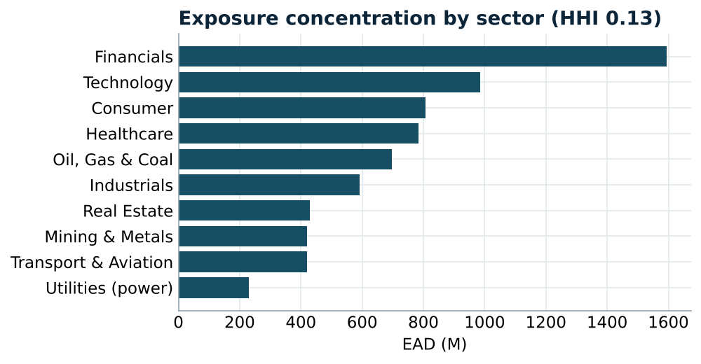
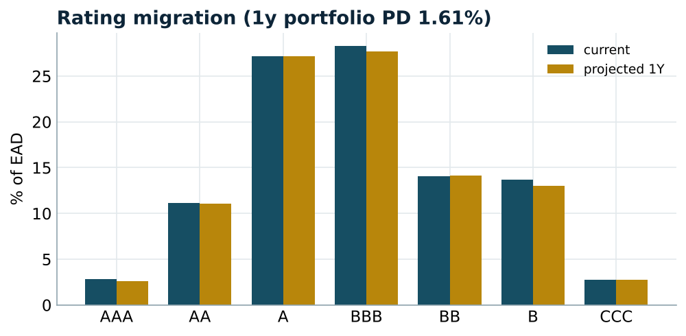
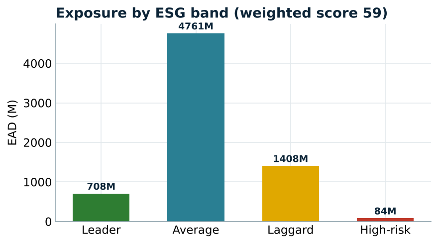
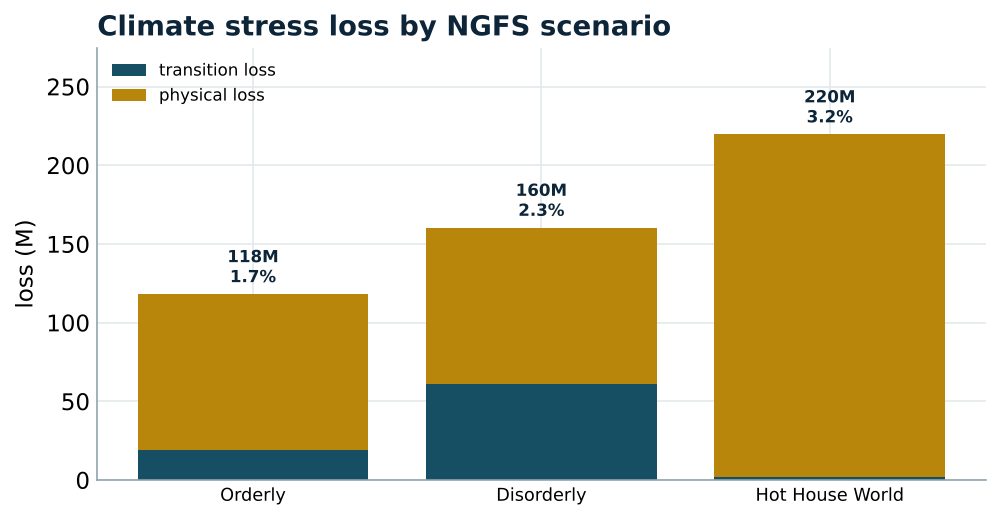

# Strategic / Portfolio Risk & ESG Engine

🚀 **[Live dashboard](https://arjinasim-strategic-esg-risk-engine-appstreamlit-app-wmslpv.streamlit.app/)** · 📄 **[Project report (PDF)](Strategic_ESG_Project_Report.pdf)**

An end-to-end **strategic / portfolio risk** engine with an **ESG and climate**
layer: exposure **concentration** analytics (HHI, top-N, Gini), **rating
migration** projection, **ESG risk scoring**, and an **NGFS climate stress test**
(transition and physical). It is the strategic-risk function's toolkit for
reporting portfolio dynamics to senior management.

Runs entirely in Google Colab, no token and no download required.

## Why this project

Mapped directly onto the BNP Paribas RISK offer's "Strategic Risk Analyst"
mission, including the explicit call to strengthen the ESG risk framework in APAC.

| Offer / mission | Module in this repo |
| --- | --- |
| Portfolio reviews & analytics over time | `concentration.py` + `migration.py` |
| Identify evolution of portfolio dynamics | `migration.py` — transition matrix, multi-year PD |
| Produce risk information for senior management | `app/streamlit_app.py` — 5-view dashboard |
| Strengthen the **ESG risk framework** in APAC | `esg.py` — E/S/G scoring, sensitive-sector exposure |
| Forward-looking / regulatory climate view | `climate.py` — NGFS transition & physical stress |

## Pipeline

```
portfolio → concentration (HHI, Gini) → rating migration → ESG scoring → NGFS climate stress → dashboard
```

## Key results

*Seeded portfolio: 200 counterparties, ~7.0bn EAD, 10 sectors, 8 APAC geographies.*

**Concentration**

| Measure | Value |
| --- | --- |
| HHI (name) | 0.015 (≈ 67 effective names) |
| Top-10 share | 30.5% |
| Gini | 0.553 |
| HHI sector / geography | 0.13 / 0.14 |

Well-diversified by effective number, with a visible single-name tail (top-10 at
30%) and a financials/industrials sector tilt.



**Rating migration** — projecting the book one year forward gives a portfolio
**1-year PD of 1.6%** (≈110M expected EAD in default), rising to 7.7% cumulative
over five years.



**ESG** — exposure-weighted ESG score **59 (Average)**, with **25%** of EAD in
ESG-sensitive sectors (oil & gas, mining, utilities, transport).



**Climate stress (NGFS)** — the Hot House World scenario is the worst at **220M
(3.2% of EAD)**, driven by physical risk, while the Disorderly transition scenario
drives the largest transition loss (61M). The trade-off between transition and
physical risk is exactly what a climate-risk review surfaces.



## Repo layout

```
src/   portfolio.py (exposures, sectors, geographies, ESG) · concentration.py (HHI, Gini)
       migration.py (transition matrix, multi-year PD) · esg.py (E/S/G scoring, bands)
       climate.py (NGFS transition & physical stress)
app/   streamlit_app.py — 5-view dashboard
tests/ test_strategic.py — 19 passing tests
scripts/ run_pipeline.py — full report to stdout
notebooks/ 01_strategic_esg.ipynb — the full Colab run
docs/  methodology.md — the one-page note
```

## Quickstart

```bash
pip install -r requirements.txt
python scripts/run_pipeline.py        # full strategic / ESG report
pytest -q                             # 19 passing tests
streamlit run app/streamlit_app.py    # the dashboard
```

No data file and no token needed: the portfolio is built deterministically.

## Methodology choices (see `docs/methodology.md`)

- **Concentration** via HHI (and effective number), top-N and Gini, by name,
  sector and geography.
- **Migration** with a through-the-cycle transition matrix and matrix powers for
  multi-year cumulative default.
- **ESG** as a risk lens: weighted E/S/G composite, risk bands, sensitive-sector
  exposure and top risk contributors.
- **Climate** following the NGFS framing: transition (carbon-price shock) and
  physical (geography hazard), across Orderly / Disorderly / Hot House World.

## Limitations & next steps

- ESG and carbon inputs are sector-level; counterparty data from an ESG provider
  would sharpen them.
- The transition matrix is through-the-cycle; a point-in-time matrix would make
  migration cycle-sensitive.
- Climate loss uses a stylised PD-uplift mapping; a full NGFS pathway model is the
  production step.

*Stating the model's own assumptions explicitly is itself a second-line posture.*
